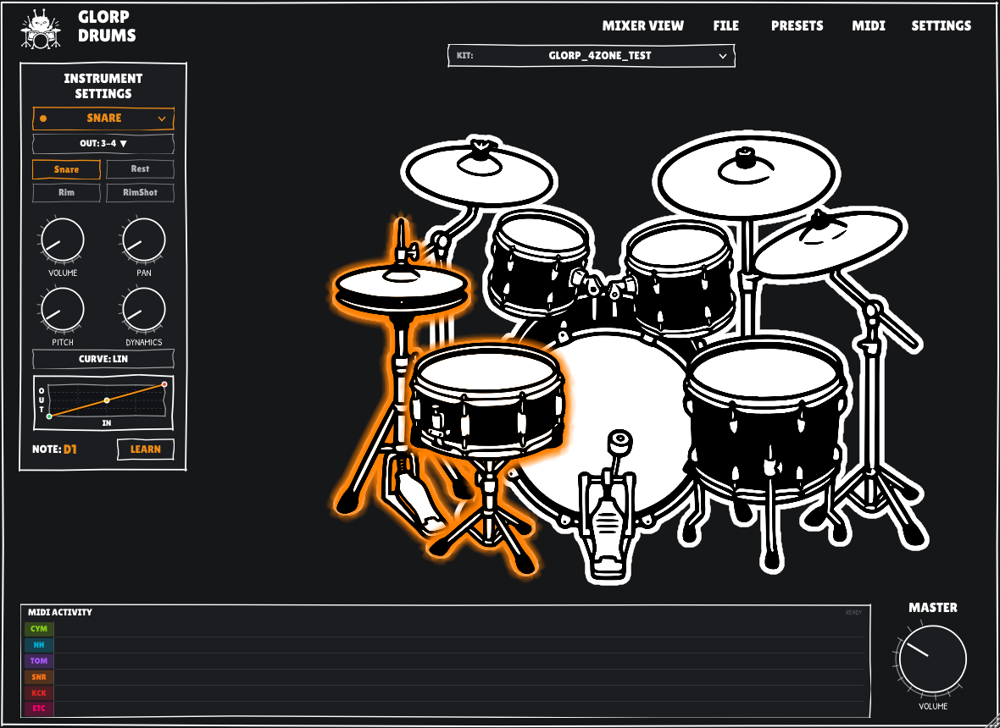
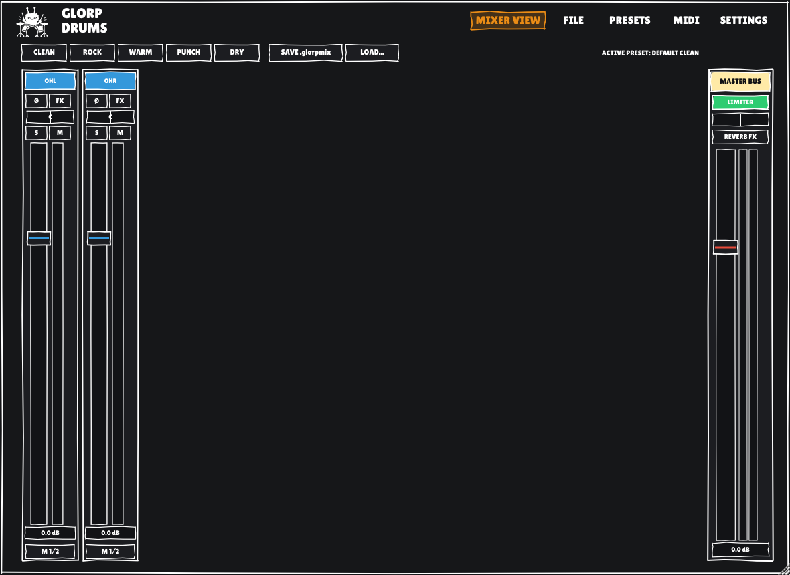
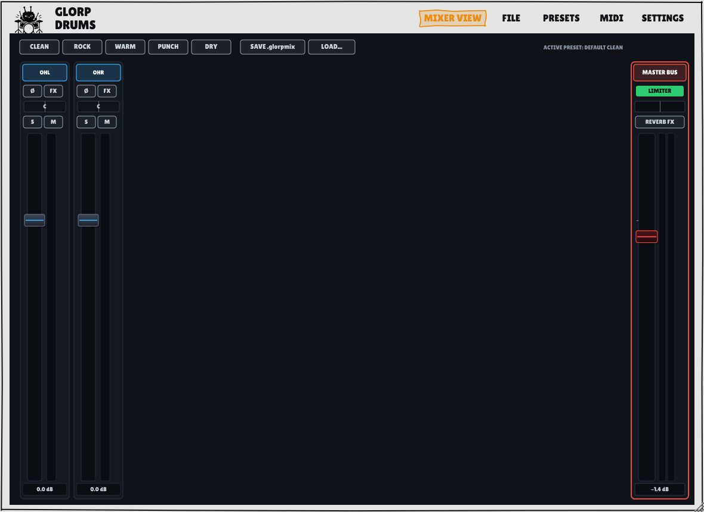
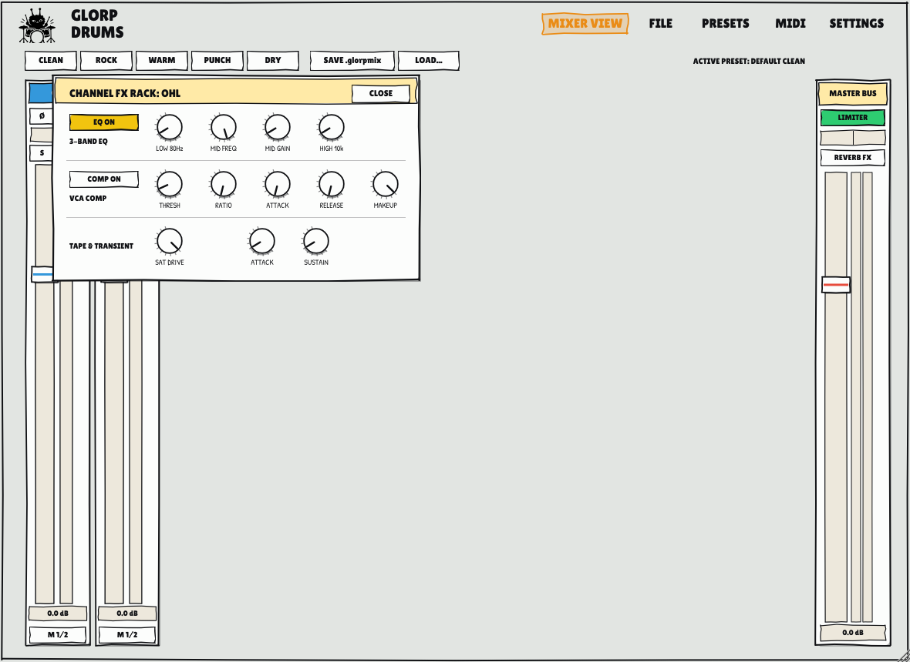
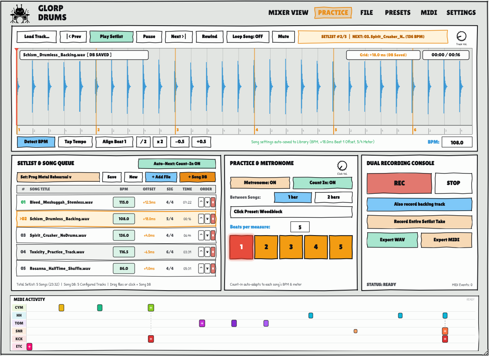
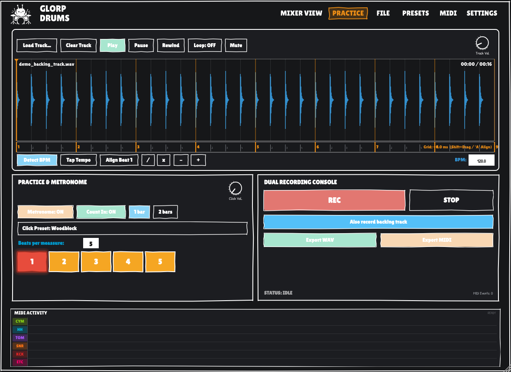
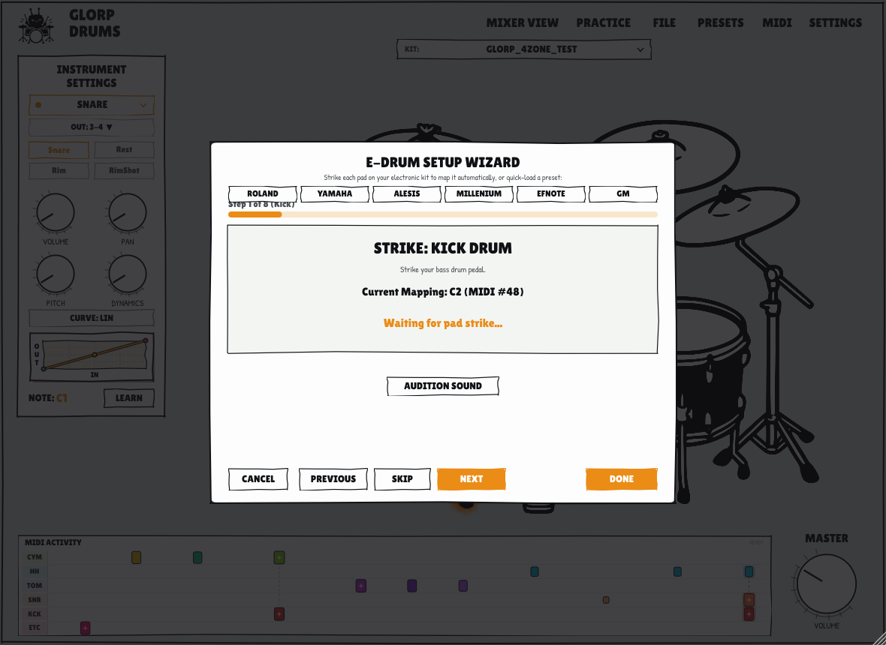

# GlorpDrums

**GlorpDrums** is a sample-based acoustic drum plugin and standalone application built with JUCE and modern C++20 for Linux musicians (with Windows and macOS ports on the roadmap). Designed to serve as the definitive open-source alternative to commercial drum samplers, GlorpDrums delivers zero-copy sample playback, multi-zone articulations, comprehensive e-drum calibration, per-instrument sound shaping, and multi-channel stem routing for professional music production.



*GlorpDrums features both a high-contrast Dark Theme with a unified comic-cutout drum kit contour and a warm, hand-drawn Light Sketch Theme.*

<details>
<summary><b>View Light (Sketch) Theme Interface</b></summary>


</details>

---

> [!NOTE]
> **Early Development & AI Assistance Disclaimer**  
> GlorpDrums is in its early stages of development and was programmed with AI assistance. While core engines (zero-copy sample streaming, DSP rack, practice/recording suite, and multi-bus routing) are fully functional and actively tested, expect rapid evolution, refinements, and ongoing polish. Feedback, bug reports, and pull requests are welcome!
>
> 🥁 **E-Drum Testers Needed!**  
> I do not currently own a physical electronic drum kit, so hardware features (continuous CC#4 hi-hat pedal tracking, velocity response curves, and cymbal chokes) have been developed and tested using MIDI simulations and virtual controllers. If you own an e-drum kit (Roland, Alesis, Yamaha, Efnote, Millenium, etc.), I would love for you to test GlorpDrums with your physical kit and share your real-world feedback, trigger responsiveness, and mapping suggestions!

---

## 🥁 Download Flagship Drum Kits

Download official and community-curated drum kits (including ReaperDrummer flagship converted kits such as **Premier Signia**, **Ludwig Black Cortex**, **CrocellKit**, and multi-velocity acoustic libraries):

👉 **[Download Drum Kits on Google Drive](https://drive.google.com/drive/folders/14eSb17o4aXm6neqrlVAfPcXrx5GzndgD?usp=drive_link)**

Place downloaded `.glorpkit` files or extracted kit folders into `~/.glorpdrums/kits/` or `~/.config/GlorpDrums/kits/`, or scan your custom download directory via **FILE $\to$ Scan Custom Folder...**

## Key Features

### 🥁 Native GlorpKit Format (`.glorpkit`)
* **Single-File Distribution**: Eliminates sprawling folders of thousands of loose WAV files by packaging full drum kits into single, standardized `.glorpkit` archives.
* **ZIP64 Architecture**: Fully supports massive multi-gigabyte sample libraries (e.g., CrocellKit 8.4 GB, multi-round-robin kits) without entry limits.
* **Zero-Copy Memory Mapping (`mmap`)**: Samples are streamed directly from the archive into memory buffers without disk extraction, ensuring near-instant kit loading and minimal memory footprint.
* **Legacy DrumGizmo Compatibility**: Seamlessly loads legacy DrumGizmo `drumkit.xml` and `midimap.xml` folder setups as a built-in fallback.

### 🎯 Multi-Zone Acoustic Engine
* **Articulated Pieces**:
  * **Snare**: Head, Rimshot, RimClick (cross-stick), and Rest/Muffled.
  * **Hi-Hat**: Closed, Semi-Open, Open, and Pedal Chick with automatic mutual choking.
  * **Cymbals**: Edge, Bow, Bell, and Choke articulations for crashes and rides.
  * **Toms**: Independent Head and Rim zones across rack and floor toms.
* **Round-Robin & Velocity Layers**: Multi-layer velocity switching and randomized round-robin variations prevent the "machine gun" effect.

### 📈 DrumGizmo-Style Velocity Curves & Preview
* **Dynamic Response Presets**: Choose between **Linear** (1:1 natural response), **Logarithmic** (boosts lighter ghost notes), **Exponential** (tightens hard hits), and **S-Curve** (exaggerates mid-range dynamics).
* **Live Visual Response Graph**: Inset display with coordinate axes (`in` on horizontal, `out` on vertical), reference grid lines, glowing response curve, and anchor points. Click directly on the preview to cycle or select curve presets.

### 🎛️ Sound Shaping & Multi-Bus DAW Routing
* **Per-Instrument Shaping**: Independent controls for **Volume**, **Pan**, **Pitch** transposition ($-12$ to $+12$ semitones with anti-aliased interpolation), and **Dynamics** response.
* **16 Discrete Stereo DAW Stems**: Up to 16 stereo output buses (32 channels total: `Out 1/2 (Main)` through `Out 31/32`) enabled by default across VST3 and LV2. Route individual instruments (Kick, Snare, Hi-Hat, Toms, Overheads, Room, etc.) to dedicated stems for professional multitrack mixing in Reaper, Ardour, Bitwig, or Carla.
* **Zero-Bleed Aux Stem Isolation**: Routed instruments automatically bypass the stereo master bus (`Out 1/2`), ensuring pristine stem separation without master mix bleed.
* **Stereo Fold-Down Safeguard**: When hosted on standard 2-channel stereo tracks, aux-routed voices automatically fold down cleanly to the main stereo output, preventing silent or dropped audio.
* **Isolated Metronome Routing**: Metronome click pulses are strictly constrained to monitor channels 1 & 2, ensuring DAW stem recordings remain completely free of click bleed.

### ⚡ 6-Lane Drum Rhythm Ribbon
* Real-time visual MIDI event stream along the bottom featuring 6 dedicated horizontal lanes (`CYM`, `HH`, `TOM`, `SNR`, `KCK`, `ETC`).
* Simultaneous hits align vertically without visual overlap, with capsule width, color coding, and intensity accents scaling dynamically to hit velocity.

---

### 🎛️ Dual-View UI & Full Per-Mic Mixer Tab
Toggle effortlessly between **[KIT VIEW]** and **[MIXER VIEW]** directly from the top header:



<details>
<summary><b>View Light (Sketch) Mixer Console</b></summary>



</details>

* **Per-Mic Channel Strips**: Complete individual strips for every mic channel (Close Kick, Snare Top, Snare Bottom, Hi-Hat, Toms, Overheads L/R, Room, Ambience, Bleed).
* **Channel Controls**: Smooth volume faders ($- \infty$ to $+6\text{ dB}$ with double-click reset to $0\text{ dB}$), stereo pan bar with center detent, Solo (`S`), Mute (`M`), and Phase Inversion (`Ø`).
* **Real-Time LED Ballistics**: Multi-segment peak and RMS LED level meters for every channel and master bus with 30 Hz refresh rate and instant overload clipping indication.
* **Master Bus Strip**: Dedicated master section pinned on the right with master fader, balance pan, brickwall soft-knee limiter, and algorithmic stereo reverb send/return.
* **Mixer Preset Architecture (`.glorpmix`)**: Quick-load factory production presets (**Default Clean**, **Massive Rock**, **Vintage Warmth**, **Punchy Studio**, **Dry & Tight**) or save and recall custom `.glorpmix` presets directly to your session.

### 🎚️ Built-In Channel Strip DSP Rack
Click the **FX** drawer on any channel strip to open an inline analog-inspired processing rack:



* **3-Band Parametric EQ**: Low shelf at $80\text{ Hz}$ ($\pm 12\text{ dB}$), sweepable peaking mid filter ($200\text{ Hz} - 6\text{ kHz}$, $Q=1.2$), and high shelf at $10\text{ kHz}$ ($\pm 12\text{ dB}$).
* **VCA Drum Compressor**: Studio compressor with adjustable Threshold ($-30\text{ dB} - 0\text{ dB}$), Ratio ($1:1 - 8:1$), Attack ($1 - 50\text{ ms}$), Release ($20 - 300\text{ ms}$), and Makeup Gain ($0 - +12\text{ dB}$).
* **Tape & Tube Saturation**: Non-linear hyperbolic tangent ($\tanh$) waveshaping for warm harmonic drive and analog thickness.
* **Transient Shaper**: Dual peak/RMS envelope follower with independent Attack and Sustain boost/cut for punchy transient snap and room decay extension.

### ⚡ E-Drum Input Engine (Continuous CC#4 & Chokes)
* **Continuous CC#4 Hi-Hat Tracking**: Smooth real-time crossfading between Closed ($0.0 - 0.20$), Semi-Open ($0.20 - 0.45$), Open Mid ($0.45 - 0.75$), and Full Open ($0.75 - 1.0$) zones based on continuous pedal movement.
* **Equal-Power Morphing**: Natural acoustic transitions powered by equal-power sinusoidal crossfade weights ($w_A = \cos(\frac{\pi}{2}\alpha), w_B = \sin(\frac{\pi}{2}\alpha)$) with zero phase cancellation.
* **Mode Switch**: Easily toggle between **Continuous CC#4 Mode (E-Drum)** and **Discrete Articulation Notes Mode (DAW / Keyboard)** in the MIDI menu.
* **Dynamic Foot Chick & Splash**: Instant foot chick triggered by fast downward pedal stomp ($\Delta CC > 0.40$ in $< 45\text{ ms}$), and foot splash triggered on rapid stomp-and-release gestures.
* **15ms Anti-Click Cymbal Chokes**: Choke damping via Polyphonic Key Pressure (`0xA0`) and Channel Pressure (`0xD0`) with a smooth $C^1$ half-cosine fade window to eliminate digital clicks.

### 🎙️ Phase 3 — Dual-Format Recording & Practice Mode
Access the integrated practice suite directly via the **[PRACTICE]** header button:



<details>
<summary><b>View Dark Theme Practice & Recording View</b></summary>



</details>

* **Synchronized Dual-Format Recording**:
  * **24-bit PCM WAV**: Captures bit-accurate audio straight from the plugin engine via a lock-free circular ring buffer (zero allocations on the real-time audio thread).
  * **Standard MIDI File (SMF Type 1)**: Simultaneously records all incoming MIDI notes, velocities, polyphonic cymbal chokes, and continuous CC#4 pedal motion curves into a `.mid` file with millisecond-accurate tempo maps.
  * **Ergonomic Dual Recording Console**: Streamlined, space-optimized layout featuring a quick one-click toggle for **"Also Record Backing Track"** to effortlessly switch between **Drums Only** (ideal for laying drum stems into a DAW project) and **Full Mix** (drums + backing track).
  * **DAW Drag-and-Drop Export**: Quickly export recorded takes to any folder or drag them straight into Reaper, Bitwig, or Ardour.
* **Smart Tempo Detection & Backing Track Player**:
  * **Multi-Format Player**: Drag-and-drop or load `.wav`, `.mp3`, `.flac`, `.aiff`, or `.ogg` backing tracks with transparent sample rate resampling, playhead scrubbing, loop regions, mute, and an enlarged comic-style **Track Vol** knob.
  * **Spectral Flux Tempo Analysis**: Real-time STFT onset novelty curve, autocorrelation across 60–200 BPM, parabolic peak interpolation, and downbeat phase alignment detect track BPM automatically with confidence scoring.
  * **Interactive BPM Controls**: Instant Tap Tempo, double/half speed (`x 2`, `/ 2`), and fine nudge (`-0.5`, `+0.5` BPM).
  * **Waveform Timeline Navigation**: Middle-click mouse drag to pan across zoomed audio, paired with an auto-following playhead that smoothly keeps playback centered in view.
* **Sample-Accurate Practice Metronome**:
  * **Count-In Toggle & Radio Controls**: Dedicated Count-In toggle switch activating **1 Bar** and **2 Bars** radio buttons (intelligently greyed out when Count-In is disabled).
  * **Pre-Roll Grid Offset**: Automatically compensates playback start so the metronome provides a full 1 or 2 bars count-in before the backing track begins.
  * **Customizable Beats Per Measure**: User-defined time signature input (defaults to 4 beats per measure) allowing practice in any meter (3/4, 4/4, 5/4, 7/8, etc.).
  * **Dynamic Reactive Beat Counter**: Flashing LED indicator lights adapt in quantity to the configured beats per measure, lighting up sequentially with high-contrast accenting on downbeats.
  * **Comic-Styled Click Preset Dropdown**: Studio-grade synthesized pulses including **Woodblock**, **Studio Beep**, **SideStick**, and **Cowbell**, with an enlarged **Click Vol** knob.
  * **Live Rhythm Ribbon**: 6-lane rolling drum ribbon provides instant visual feedback on timing accuracy across Kick, Snare, Hi-Hat, Toms, Cymbals, and Ride.

---

## E-Drum Calibration & Setup Wizard

GlorpDrums is purpose-built for electronic drum kits. An integrated **E-Drum Setup Wizard** calibrates pads, cymbals, and pedals in seconds:



* **Hardware Presets**: Pre-configured MIDI mappings for **Roland**, **Yamaha**, **Alesis**, **Millenium**, **Efnote**, **General MIDI (GM)**, **ReaperDrummer**, and standard **DrumGizmo**.
* **Interactive Step-by-Step Calibration**: Simply strike each physical pad when prompted to automatically detect and assign MIDI note numbers.
* **Instant MIDI Learn**: Arm the `LEARN` button next to any instrument or zone to bind incoming MIDI notes on the fly.
* **Community Hardware Feedback**: Since I don't currently own an electronic drum kit, real-world feedback from e-drum players is hugely appreciated! If your kit or module model needs custom mappings or calibration tweaks, please share them so we can expand our built-in factory presets.

---

## Roadmap

GlorpDrums is actively developed following an ambitious multi-phase roadmap:

* [x] **Phase 1 — E-Drum Input Engine**: Continuous CC#4 hi-hat crossfading, foot chick/splash gestures, and 15ms anti-click cymbal choke damping.
* [x] **Phase 2 — Full Per-Mic Mixer Tab & Built-in DSP**: Dual-view UI switch ([KIT VIEW] / [MIXER VIEW]), per-mic strips, 3-band EQ, VCA compressor, saturation, transient shaper, master limiter, reverb, and `.glorpmix` presets.
* [x] **Phase 3 — Recording Mode & Practice Assistant**: Synchronized 24-bit WAV + SMF Type 1 MIDI recording, backing track player with interactive waveform navigation (middle-click pan & auto-following playhead), spectral-flux tempo detection, sample-accurate metronome with customizable beats per measure, dynamic LED count lights, pre-roll count-in, and 6-lane rolling rhythm ribbon.
* [ ] **Phase 4 — Multi-Mic Leakage & Bleed Matrix**: Realistic snare top bleed into kick mic, tom bleed into overheads, and controllable acoustic crosstalk.
* [ ] **Phase 5 — Cross-Platform Port (Windows & macOS)**:
  * Port standalone application and plugin formats (VST3 and CLAP) to **Windows 10/11** with low-latency ASIO and WASAPI audio driver support.
  * Port standalone application and plugin formats (VST3, CLAP, and **AU / Audio Unit**) to **macOS** with CoreAudio and CoreMIDI support.
  * Universal binary support for macOS (native Apple Silicon ARM64 and Intel x86_64).
  * Automated cross-platform packaging, installer generation, and code signing.
* [ ] **Phase 6 — Internationalization (i18n) & Multi-Language Support**:
  * Localization architecture for dynamic runtime translation across all UI screens, menus, dialogs, and the e-drum setup wizard.
  * Initial translations for Spanish, German, French, Japanese, Portuguese, Chinese, and other languages.
  * Community translation template and localized documentation.

---

## Requirements and Build Instructions

### Prerequisites (Linux)
* CMake 3.22 or higher
* C++20 compatible compiler (GCC 11+ or Clang 14+)
* Linux development headers (ALSA, JACK, FreeType, FontConfig, OpenGL, X11):
  ```bash
  sudo apt install build-essential cmake pkg-config \
                   libasound2-dev libjack-jackd2-dev \
                   libfreetype-dev libfontconfig1-dev libgl1-mesa-dev \
                   libx11-dev libxcomposite-dev libxcursor-dev \
                   libxext-dev libxinerama-dev libxrandr-dev libxrender-dev
  ```

GlorpDrums supports **ALSA**, **JACK**, and **PipeWire** (via PipeWire-JACK or PipeWire-ALSA). For live e-drum performance, JACK / PipeWire-JACK is recommended for minimum latency.

### Building

1. Configure the build with CMake:
   ```bash
   cmake -B build -DCMAKE_BUILD_TYPE=Release
   ```
2. Compile binaries:
   ```bash
   cmake --build build --config Release -j$(nproc)
   ```

Outputs in `build/GlorpDrums_artefacts/Release/`:
* `Standalone/GlorpDrums` — Standalone executable
* `VST3/GlorpDrums.vst3` — VST3 plugin bundle
* `LV2/GlorpDrums.lv2` — LV2 plugin bundle

### Installation

To copy plugin bundles and the standalone binary to your standard user directories (`~/.vst3/`, `~/.lv2/`, and `~/.local/bin/`):
```bash
./tools/install.sh
```

Or to quickly update only the DAW plugin scan folders:
```bash
./tools/install_plugins.sh
```

---

## Drum Kit Locations

GlorpDrums automatically scans the following directories for `.glorpkit` files and DrumGizmo XML manifests:
* `~/.glorpdrums/kits/` (Recommended)
* `~/.config/GlorpDrums/kits/`
* `~/DrumGizmo/kits/`
* `~/.local/share/drumgizmo/kits/`
* `~/Documents/drumgizmo/kits/`
* Custom directories configured via **FILE $\to$ Scan Custom Folder...** or the `GLORP_KITS_PATH` environment variable.

---

## License

GlorpDrums is open-source software licensed under the GNU General Public License v3 (GPLv3).
