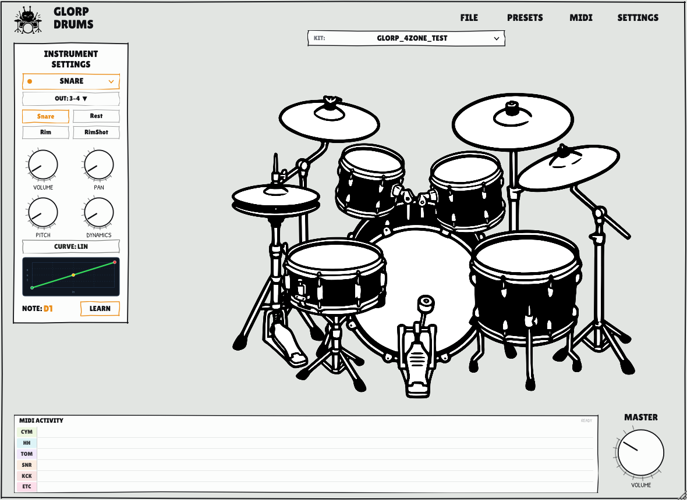

# GlorpDrums

GlorpDrums is a sample-based acoustic drum plugin and standalone application built with JUCE. It loads drum kits formatted for the DrumGizmo XML standard and supports multi-zone articulations, velocity layers, round-robin variations, choke groups, per-zone sound shaping, and multi-channel DAW output routing.



---

## Features

* **Multi-Zone Articulations**: Supports multi-zone instruments grouped by drum piece:
  * **Snare**: Head, Rimshot, RimClick (crosstick), and Rest/Muffled.
  * **Toms**: Head and Rim zones for rack and floor toms.
  * **Hi-Hat**: Closed, Semi-Open, Open, and Pedal with automatic mutual choking.
  * **Cymbals**: Edge, Bow, Bell, and Choke articulations for crashes and rides.
* **Per-Zone Sound Shaping**: Independent Volume, Pan, Pitch shift (-12 to +12 semitones), and Velocity Dynamics response per zone.
* **Multi-Channel DAW Routing**: Supports up to 16 discrete stereo output buses, allowing individual kit pieces to be routed to dedicated mixer tracks in Ardour, Reaper, Bitwig, or other DAWs.
* **6-Lane Drum Rhythm Ribbon**: Real-time MIDI activity strip along the bottom displaying hits across dedicated horizontal lanes (`CYM`, `HH`, `TOM`, `SNR`, `KCK`, `ETC`). Simultaneous strikes (e.g. Kick + Snare + Hi-Hat) align vertically without visual overlap, with capsule width, color, and accents scaling by strike intensity.
* **Kit Selector**: Dropdown above the kit graphic to switch between scanned kit directories or browse for any `drumkit.xml` file.
* **Interactive Kit Graphic**: Click drum pieces to audition hits and navigate instrument settings; displays real-time hit glow animations during playback.
* **MIDI Mapping & MIDI Learn**: Interactive MIDI learn per zone, plus support for standard DrumGizmo `midimap.xml` files.

---

## Requirements and Build Instructions

### Prerequisites (Linux)
* CMake 3.22 or higher
* C++20 compatible compiler (GCC 11+ or Clang 14+)
* JUCE Linux system dependencies (ALSA, JACK, FreeType, X11, OpenGL development headers):
  ```bash
  sudo apt install build-essential cmake libasound2-dev libjack-jackd2-dev \
                   libfreetype-dev libx11-dev libxcomposite-dev libxcursor-dev \
                   libxext-dev libxinerama-dev libxrandr-dev libxrender-dev
  ```

The standalone app supports ALSA, JACK, and PipeWire (via JACK or ALSA compatibility). For live performance, JACK is recommended for lowest latency.

### Building

1. Configure the build with CMake:
   ```bash
   cmake -B build -DCMAKE_BUILD_TYPE=Release
   ```
2. Compile the binaries:
   ```bash
   cmake --build build --config Release -j$(nproc)
   ```

Compilation generates the following targets in `build/GlorpDrums_artefacts/Release/`:
* `Standalone/GlorpDrums` — Standalone executable
* `VST3/GlorpDrums.vst3` — VST3 plugin bundle
* `LV2/GlorpDrums.lv2` — LV2 plugin bundle

### Installation

To copy the plugin bundles and standalone binary to your user directories (`~/.vst3/`, `~/.lv2/`, and `~/.local/bin/`):
```bash
./tools/install.sh
```

Or to quickly update just the VST3 and LV2 plugins in your DAW scan folders:
```bash
./tools/install_plugins.sh
```

---

## Kit Generation Tools

GlorpDrums includes automated Python scripts in `tools/` for converting and extracting drum kits into standard DrumGizmo XML format.

### 1. EZDrummer Sample Ripper (`tools/sample_ripper/`)

This tool automates sampling virtual drum instruments (such as EZDrummer 3) by generating a mathematically timed MIDI track, capturing the audio in your DAW, and slicing the resulting recording into properly structured DrumGizmo kits.

#### Step 1: Generate the Sampling MIDI File
Run the MIDI track generator:
```bash
python3 tools/sample_ripper/make_sampling_midi.py ./capture
```
This generates:
* `capture/sampling_track.mid`: A Standard MIDI File (Channel 10) containing 20 drum articulations across 6 velocity tiers (20, 42, 64, 85, 106, 127) and 3 round-robin iterations (360 total hits). Cymbals and open hi-hats have extended decay spacing (up to 10.5 seconds) to prevent sample tail overlap. Hi-hat pedal open/close positions are automated using MIDI CC #4.
* `capture/sampling_manifest.json`: Precise timestamps and articulation metadata used by the slicing script.

#### Step 2: Render in Your DAW
1. Open your DAW (e.g. Ardour 8, Reaper) and create a MIDI track loaded with EZDrummer 3.
2. Select your desired kit, tuning, and room mic balance in the EZDrummer interface.
3. Import `capture/sampling_track.mid` onto the track, aligned to timeline start (`00:00:00`).
4. Export/bounce the master track offline to a stereo WAV file (24-bit, 44.1 kHz or 48 kHz), e.g. `./capture/render.wav`.

#### Step 3: Slice and Assemble the Kit
Run the slicing and kit builder script:
```bash
python3 tools/sample_ripper/slice_and_build_kit.py \
    ./capture/render.wav \
    ./capture/sampling_manifest.json \
    ~/.config/GlorpDrums/kits/EZD_MyKit \
    "EZD Custom Kit"
```
The script will:
* Detect audio onset transients around each scheduled timestamp, accounting for plugin and DAW latency.
* Apply pre-roll and anti-click fades to preserve attack clicks and clean sample tails.
* Export all 360 sliced 24-bit WAV files into instrument subdirectories.
* Generate `instruments/*.xml` files with normalized sample power curves.
* Generate `drumkit.xml` with channel mappings and mutual choke rules (closed/semi-open hats choking open hats).
* Generate `midimap.xml` matching standard General MIDI note layouts.

---

### 2. ReaperDrummer Kit Organizer (`tools/organize_reaperdrummer_kits.py`)

This script organizes multi-channel drum recordings (such as the free ReaperDrummer sample packs: *Ludwig Black Cortex* and *Premier Signia*) into DrumGizmo XML kits.

#### Usage:
1. Place your uncompressed ReaperDrummer sample folders in your kits directory (e.g., `/home/<user>/DrumGizmo/kits/`).
2. Run the script:
   ```bash
   python3 tools/organize_reaperdrummer_kits.py
   ```
3. The script scans the WAV file naming patterns (e.g., `Snare A 01.wav`, `Hihat Spl 08.wav`), detects multi-channel audio tracks (direct mics, overheads, room mics), and builds:
   * Multi-channel instrument XML files with calibrated velocity power curves.
   * `drumkit.xml` with multichannel routing (`DIRECT`, `OHL`, `OHR`, `AMBL`, `AMBR`).
   * Choke groupings for open hi-hats and cymbals.
   * `midimap.xml` mapping MIDI notes to each articulation.

---

## Loading Kits in GlorpDrums

1. In GlorpDrums, click the **KIT** dropdown above the drum kit graphic (or use **FILE -> Load DrumKit (.xml)...**).
2. Select a kit from the scanned list, or browse to any `drumkit.xml` file on disk.
3. Kit configurations, zone assignments, choke groups, and round robins will load automatically.

---

## Project Structure

```
GlorpDrums/
├── CMakeLists.txt                # Build configuration (JUCE targets)
├── src/
│   ├── core/                     # Audio engine, sampler, voice allocation, XML parsing
│   │   ├── DrumKit.cpp/h         # Kit data structures and XML loader
│   │   ├── Sampler.cpp/h         # Polyphonic voice playback and multi-out routing
│   │   ├── MidiMap.cpp/h         # MIDI note mappings and MIDI learn
│   │   └── Settings.cpp/h       # Persistent configuration
│   ├── plugin/                   # JUCE AudioProcessor & AudioProcessorEditor
│   │   ├── PluginProcessor.cpp/h # Audio processing and bus negotiation
│   │   └── PluginEditor.h        # Editor wrapper
│   └── ui/                       # User interface components
│       ├── Editor.cpp/h          # Main window layout and controls
│       ├── DrumKitView.cpp/h     # Interactive drum kit visualizer
│       ├── Scope.cpp/h           # 6-lane Drum Rhythm Ribbon MIDI activity strip
│       ├── Knob.cpp/h            # Sketched rotary controls
│       └── Theme.h               # Graphic styling, fonts, and colors
├── tools/
│   ├── sample_ripper/            # EZDrummer sampling MIDI generator and slicer
│   ├── organize_reaperdrummer_kits.py # ReaperDrummer multi-channel kit organizer
│   ├── install.sh                # Full installation script
│   └── install_plugins.sh        # Plugin-only deployment script
└── docs/
    └── screenshot.png            # Interface screenshot
```

---

## License

GlorpDrums is released under the GNU Affero General Public License v3.0 (AGPLv3).

This license is required because GlorpDrums uses the JUCE framework, which is licensed under AGPLv3. The full license text is in the `LICENSE` file.

If you need a different license, please contact the maintainers.
