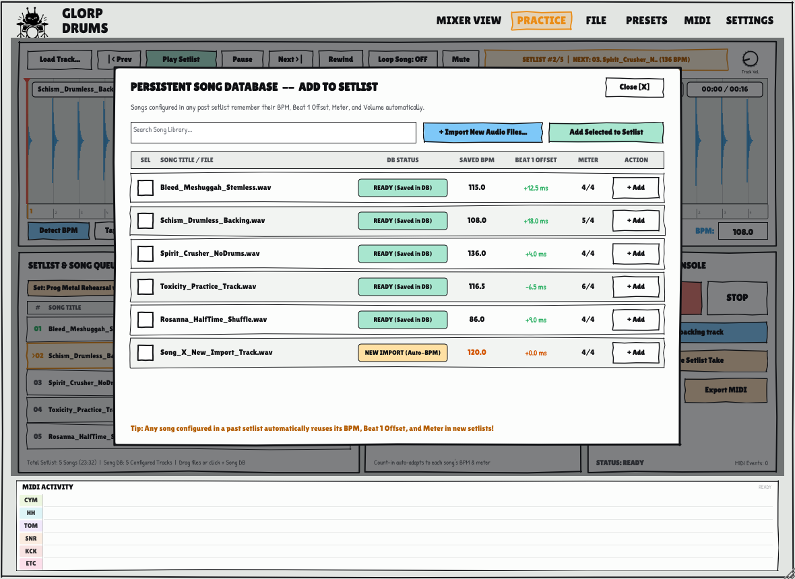
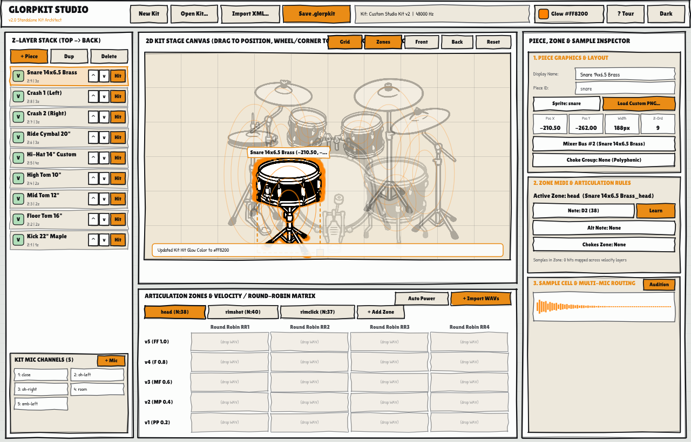
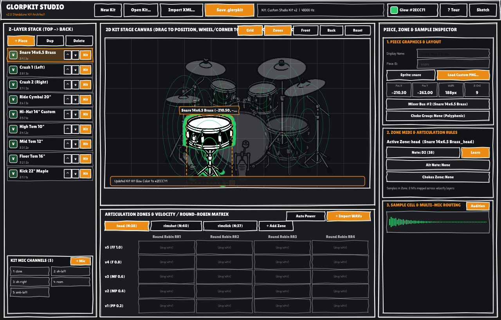
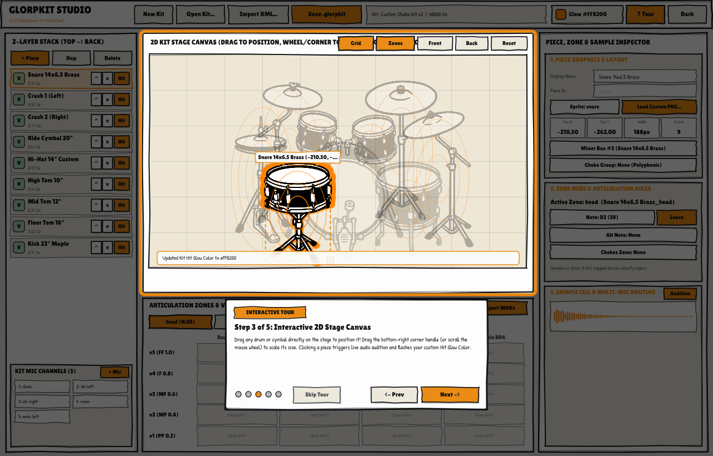

# GlorpDrums

**GlorpDrums** is a sample-based acoustic drum plugin and standalone application built with JUCE and modern C++20 for Linux musicians (with Windows and macOS ports on the roadmap). Designed to serve as the definitive open-source alternative to commercial drum samplers, GlorpDrums delivers zero-copy sample playback, multi-zone articulations, comprehensive e-drum calibration, per-instrument sound shaping, and multi-channel stem routing for professional music production.


*GlorpDrums features both a high-contrast Dark Theme with a unified comic-cutout drum kit contour and a warm, hand-drawn Light Sketch Theme.*

<details>
<summary><b>View Light (Sketch) Theme Interface</b></summary>


</details>

---

> [!NOTE]
> **Early Development & AI Assistance Disclaimer**  
> GlorpDrums is in its early stages of development and was programmed with AI assistance. While core engines (zero-copy sample streaming, DSP rack, practice/recording suite, and multi-bus routing) are fully functional and actively tested, expect rapid evolution, refinements, and ongoing polish. Feedback, bug reports, and pull requests are welcome!
>
> 🥁 **E-Drum Testers Needed!**  
> I do not currently own a physical electronic drum kit, so hardware features (continuous CC#4 hi-hat pedal tracking, velocity response curves, and cymbal chokes) have been developed and tested using MIDI simulations and virtual controllers. If you own an e-drum kit (Roland, Alesis, Yamaha, Efnote, Millenium, etc.), I would love for you to test GlorpDrums with your physical kit and share your real-world feedback, trigger responsiveness, and mapping suggestions!

---

## 🥁 Download Flagship Drum Kits

Download official and community-curated drum kits (including ReaperDrummer flagship converted kits such as **Premier Signia**, **Ludwig Black Cortex**, **CrocellKit**, and multi-velocity acoustic libraries):

👉 **[Download Drum Kits on Google Drive](https://drive.google.com/drive/folders/14eSb17o4aXm6neqrlVAfPcXrx5GzndgD?usp=drive_link)**

Place downloaded `.glorpkit` files or extracted kit folders into `~/.glorpdrums/kits/` or `~/.config/GlorpDrums/kits/`, or scan your custom download directory via **FILE $\to$ Scan Custom Folder...**

## Key Features

### 🥁 Native GlorpKit Format (`.glorpkit`)
* **Single-File Distribution**: Eliminates sprawling folders of thousands of loose WAV files by packaging full drum kits into single, standardized `.glorpkit` archives.
* **ZIP64 Architecture**: Fully supports massive multi-gigabyte sample libraries (e.g., CrocellKit 8.4 GB, multi-round-robin kits) without entry limits.
* **Zero-Copy Memory Mapping (`mmap`)**: Samples are streamed directly from the archive into memory buffers without disk extraction, ensuring near-instant kit loading and minimal memory footprint.
* **Legacy DrumGizmo Compatibility**: Seamlessly loads legacy DrumGizmo `drumkit.xml` and `midimap.xml` folder setups as a built-in fallback.

### 🎯 Multi-Zone Acoustic Engine
* **Articulated Pieces**:
  * **Snare**: Head, Rimshot, RimClick (cross-stick), and Rest/Muffled.
  * **Hi-Hat**: Closed, Semi-Open, Open, and Pedal Chick with automatic mutual choking.
  * **Cymbals**: Edge, Bow, Bell, and Choke articulations for crashes and rides.
  * **Toms**: Independent Head and Rim zones across rack and floor toms.
* **Round-Robin & Velocity Layers**: Multi-layer velocity switching and randomized round-robin variations prevent the "machine gun" effect.

### 📈 DrumGizmo-Style Velocity Curves & Preview
* **Dynamic Response Presets**: Choose between **Linear** (1:1 natural response), **Logarithmic** (boosts lighter ghost notes), **Exponential** (tightens hard hits), and **S-Curve** (exaggerates mid-range dynamics).
* **Live Visual Response Graph**: Inset display with coordinate axes (`in` on horizontal, `out` on vertical), reference grid lines, glowing response curve, and anchor points. Click directly on the preview to cycle or select curve presets.

### 🎛️ Sound Shaping & Multi-Bus DAW Routing
* **Per-Instrument Shaping**: Independent controls for **Volume**, **Pan**, **Pitch** transposition ($-12$ to $+12$ semitones with anti-aliased interpolation), and **Dynamics** response.
* **16 Discrete Stereo DAW Stems**: Up to 16 stereo output buses (32 channels total: `Out 1/2 (Main)` through `Out 31/32`) enabled by default across VST3 and LV2. Route individual instruments (Kick, Snare, Hi-Hat, Toms, Overheads, Room, etc.) to dedicated stems for professional multitrack mixing in Reaper, Ardour, Bitwig, or Carla.
* **Zero-Bleed Aux Stem Isolation**: Routed instruments automatically bypass the stereo master bus (`Out 1/2`), ensuring pristine stem separation without master mix bleed.
* **Stereo Fold-Down Safeguard**: When hosted on standard 2-channel stereo tracks, aux-routed voices automatically fold down cleanly to the main stereo output, preventing silent or dropped audio.
* **Isolated Metronome Routing**: Metronome click pulses are strictly constrained to monitor channels 1 & 2, ensuring DAW stem recordings remain completely free of click bleed.

### ⚡ 6-Lane Drum Rhythm Ribbon
* Real-time visual MIDI event stream along the bottom featuring 6 dedicated horizontal lanes (`CYM`, `HH`, `TOM`, `SNR`, `KCK`, `ETC`).
* Simultaneous hits align vertically without visual overlap, with capsule width, color coding, and intensity accents scaling dynamically to hit velocity.

---

### 🎛️ Dual-View UI & Full Per-Mic Mixer Tab
Toggle effortlessly between **[KIT VIEW]** and **[MIXER VIEW]** directly from the top header:


<details>
<summary><b>View Light (Sketch) Mixer Console</b></summary>


</details>

* **Per-Mic Channel Strips**: Complete individual strips for every mic channel (Close Kick, Snare Top, Snare Bottom, Hi-Hat, Toms, Overheads L/R, Room, Ambience, Bleed).
* **Channel Controls**: Smooth volume faders ($- \infty$ to $+6\text{ dB}$ with double-click reset to $0\text{ dB}$), stereo pan bar with center detent, Solo (`S`), Mute (`M`), and Phase Inversion (`Ø`).
* **Real-Time LED Ballistics**: Multi-segment peak and RMS LED level meters for every channel and master bus with 30 Hz refresh rate and instant overload clipping indication.
* **Master Bus Strip**: Dedicated master section pinned on the right with master fader, balance pan, brickwall soft-knee limiter, and algorithmic stereo reverb send/return.
* **Mixer Preset Architecture (`.glorpmix`)**: Quick-load factory production presets (**Default Clean**, **Massive Rock**, **Vintage Warmth**, **Punchy Studio**, **Dry & Tight**) or save and recall custom `.glorpmix` presets directly to your session.

### 🎚️ Built-In Channel Strip DSP Rack
Click the **FX** drawer on any channel strip to open an inline analog-inspired processing rack:


* **3-Band Parametric EQ**: Low shelf at $80\text{ Hz}$ ($\pm 12\text{ dB}$), sweepable peaking mid filter ($200\text{ Hz} - 6\text{ kHz}$, $Q=1.2$), and high shelf at $10\text{ kHz}$ ($\pm 12\text{ dB}$).
* **VCA Drum Compressor**: Studio compressor with adjustable Threshold ($-30\text{ dB} - 0\text{ dB}$), Ratio ($1:1 - 8:1$), Attack ($1 - 50\text{ ms}$), Release ($20 - 300\text{ ms}$), and Makeup Gain ($0 - +12\text{ dB}$).
* **Tape & Tube Saturation**: Non-linear hyperbolic tangent ($\tanh$) waveshaping for warm harmonic drive and analog thickness.
* **Transient Shaper**: Dual peak/RMS envelope follower with independent Attack and Sustain boost/cut for punchy transient snap and room decay extension.

### ⚡ E-Drum Input Engine (Continuous CC#4 & Chokes)
* **Continuous CC#4 Hi-Hat Tracking**: Smooth real-time crossfading between Closed ($0.0 - 0.20$), Semi-Open ($0.20 - 0.45$), Open Mid ($0.45 - 0.75$), and Full Open ($0.75 - 1.0$) zones based on continuous pedal movement.
* **Equal-Power Morphing**: Natural acoustic transitions powered by equal-power sinusoidal crossfade weights ($w_A = \cos(\frac{\pi}{2}\alpha), w_B = \sin(\frac{\pi}{2}\alpha)$) with zero phase cancellation.
* **Mode Switch**: Easily toggle between **Continuous CC#4 Mode (E-Drum)** and **Discrete Articulation Notes Mode (DAW / Keyboard)** in the MIDI menu.
* **Dynamic Foot Chick & Splash**: Instant foot chick triggered by fast downward pedal stomp ($\Delta CC > 0.40$ in $< 45\text{ ms}$), and foot splash triggered on rapid stomp-and-release gestures.
* **15ms Anti-Click Cymbal Chokes**: Choke damping via Polyphonic Key Pressure (`0xA0`) and Channel Pressure (`0xD0`) with a smooth $C^1$ half-cosine fade window to eliminate digital clicks.

### 🎙️ Practice Suite — Set Lists, Persistent Song Database & Dual Recording
Access the integrated practice, setlist, and recording suite directly via the **[PRACTICE]** header button:


<details>
<summary><b>View Dark Theme Practice View & Persistent Song Database Modal</b></summary>




</details>

* **Setlist & Song Queue Console**:
  * **Multi-Setlist Management**: Create, switch between, and delete multiple named setlists (e.g., *Prog Metal Rehearsal*, *Friday Gig Warmup*) directly from the `Set:` selector dropdown or the **New** / **Save** buttons.
  * **Interactive Song Queue Table**: Displays each track's position (`#01`, `>02`, `03`...), title, configured **BPM** badge, **Beat-1 Grid Offset** (`+18.0ms`), **Time Signature** (`5/4`, `4/4`, `6/4`), and duration (`MM:SS`), along with inline `^`, `v`, and `x` buttons to reorder or remove songs on the fly.
  * **Single-Click Inspection vs. Double-Click Playback**:
    * **Single-click any row** in the queue to load that backing track into the top Waveform Deck so you can inspect transients, scrub the timeline, or fine-tune its BPM, Beat-1 offset, or meter.
    * **Double-click any row** (or click **Play Setlist** / `|< Prev` / `Next >|`) to start sequential setlist playback from that song.
  * **Seamless Between-Song Count-In Transitions**:
    * While Song $N$ is playing, a background thread pre-decodes and resamples Song $N+1$ into a standby RAM buffer (`BackingTrackPlayer::preloadFile`) so transitions require zero disk I/O.
    * When Song $N$ finishes at EOF and **Auto-Next: Count-In ON** is active, GlorpDrums immediately swaps in Song $N+1$, updates the metronome and beat LEDs to Song $N+1$'s saved **BPM**, **Beat-1 Grid Offset**, and **Beats per measure**, displays a live `COUNT-IN TO SONG #N` banner over the waveform, plays a **1-bar** or **2-bar** count-in at the incoming song's tempo and meter, and launches Song $N+1$ sample-accurately on Beat 1.
    * Setlists continue advancing automatically even if you switch to the **[KIT VIEW]** or **[MIXER VIEW]** tab mid-performance.
* **Persistent Song Library Database (`~/.config/GlorpDrums/song_library.xml`)**:
  * **Configure Once, Reuse Across Every Setlist**: Every audio file imported into GlorpDrums is indexed in `song_library.xml` by its canonical file path (with automatic filename + file-size fallback if you move your backing track files).
  * **Instant Auto-Save**: Whenever you run **Detect BPM**, **Tap Tempo**, **Align Beat 1** (or `Shift+Drag` on the beat ruler / press `A`), `/ 2`, `x 2`, `-0.5`, `+0.5`, type a custom **BPM**, change **Beats per measure**, or adjust **Track Vol.**, those settings are immediately saved to the Song Library and confirmed by the `[ DB SAVED ]` waveform badge.
  * **Zero Re-Setup in New Setlists (`+ Song DB` Modal)**: Click **+ Song DB** to open the **Persistent Song Database** overlay, where you can search your entire library of previously configured songs (marked with a green `READY (Saved in DB)` badge) or batch-import new audio files. If you configure Songs `A`, `B`, and `C` in Setlist 1, and later create Setlist 2 with new Songs `X`, `Y`, and existing Song `A`, Song `A` is added with its exact BPM, Beat-1 offset, meter, and volume already locked in—you only need to set up the new songs `X` and `Y`.
* **Smart Tempo Detection & Full-Width Waveform Deck**:
  * **Multi-Format Player**: Drag-and-drop or load `.wav`, `.mp3`, `.flac`, `.aiff`, or `.ogg` backing tracks with automatic host-rate resampling, playhead audio scrubbing, loop toggle (`Loop Song`), mute, a live setlist status pill (`SETLIST #2/5 | NEXT: 03. Spirit_Crusher (136 BPM)`), and a comic-style **Track Vol.** knob.
  * **Multi-Window Spectral Flux Tempo Analysis**: Real-time STFT onset novelty curve, autocorrelation across 60–200 BPM, harmonic double/half-time resolver, and downbeat phase alignment detect track BPM and Beat-1 offset automatically with confidence scoring. When zoomed in (`> 1.25x`), **Detect BPM** analyzes only the currently visible waveform slice so you can measure sections with tempo changes.
  * **Meter-Aware Beat Grid & Timeline Navigation**: Mouse-wheel zoom (`1x` to `32x`), middle-click drag to pan, `Shift+Drag` (or drag inside the beat ruler) to slide the Beat-1 grid offset in real time, and vertical bar/beat guidelines that automatically adapt to the song's `Beats per measure` (`4/4`, `5/4`, `6/4`, `7/8`, etc.).
* **Sample-Accurate Practice Metronome**:
  * **Count-In & Between-Song Bar Controls**: Dedicated **Count In: ON/OFF** toggle paired with **Between Songs: [1 bar] [2 bars]** selectors.
  * **Phase-Locked Grid Offset**: Locks metronome clicks and count-in pre-roll math to the song's Beat-1 offset so the click stays tight with the backing track's downbeat from the very first bar.
  * **Dynamic Reactive Beat Counter**: Flashing LED indicator cards (`1..N`) adapt dynamically to the current song's `Beats per measure`, lighting up with a radiant red downbeat aura on Beat 1 and golden sub-beat pulses.
  * **8 Synthesized Click Presets**: Choose between **Woodblock**, **Studio Click**, **Side Stick**, **Cowbell**, **Hi-Hat Pedal**, **Digital Beep**, **Clave**, and **Triangle**, with an independent **Click Vol.** knob.
* **Synchronized Dual-Format Recording Console**:
  * **24-bit PCM WAV + SMF Type 1 MIDI**: Simultaneously captures 24-bit audio via a lock-free ring buffer and standard `.mid` events (notes, velocities, polyphonic cymbal chokes, and continuous CC#4 hi-hat pedal curves).
  * **Also Record Backing Track**: Toggle between recording **Drums Only** (isolated drum performance with zero click or backing bleed) and **Full Mix** (drums + backing track, still excluding the metronome click).
  * **Record Entire Setlist Take**: Keep recording armed across an entire multi-song setlist rehearsal to capture a continuous end-to-end WAV and MIDI performance across all songs and count-in transitions, or toggle off to stop recording after a single song.

---

### 🎚️ Phase 4 — Multi-Mic Leakage & Bleed Matrix
GlorpDrums provides studio-grade acoustic bleed control to bridge the gap between sterile isolated multi-samples and natural live acoustic drum kits. Open the matrix at any time using the **[BLEED MATRIX]** button in the mixer header or via the per-channel **BLD** strip buttons:

* **Logical Drum Piece Grid ($9 \times N$)**:
  * Rows organized cleanly by logical kit pieces (**Kick**, **Snare**, **Tom 1**, **Tom 2**, **Floor Tom**, **Hi-Hat**, **Ride**, **Crash 1**, **Crash 2**) mapped against all loaded kit mic channels.
  * **Tactile Cell Editing**: Click and drag up/down on any cell to adjust bleed gain (default $0\text{ dB}$, adjustable $- \infty$ to $+6\text{ dB}$), right-click or Shift-click to instantly mute an individual leakage path, and double-click to reset.
* **Physical Acoustic Crosstalk Engine**:
  * **Inter-Mic Acoustic Delay**: Emulates physical acoustic sound wave travel times across the drum kit ($1.5 - 5\text{ ms}$ delay ring buffer).
  * **Off-Axis Cardioid Filtering**: Simulates acoustic shadow and frequency-dependent polar patterns with 1-pole low-pass filtering on off-axis bleed signals.
  * **Sympathetic Snare Wire Rattle**: Physical acoustic synthesis model simulating sympathetic bottom snare wire vibration and buzz when the Kick drum or Low Toms are struck, featuring an active 3.2 kHz resonant bandpass filter and exponential envelope decay.
* **Engine Modes & Production Presets**:
  * **Hybrid Acoustic**: Scales recorded multi-mic sample bleeds while augmenting dry mics with synthetic physical crosstalk and sympathetic resonance.
  * **Recorded Only**: Exclusively scales multi-mic spill captured in sample archives.
  * **Mute Bleed**: Complete isolation for razor-sharp modern metal and pop productions.
  * **One-Click Presets**: **Natural** (default studio spill), **Clean** (bleed muted), **Live** (+3 dB extra room and shell spill with prominent snare buzz), and **OH Only** (mutes close mic spill while retaining overhead and room ambiance).
* **Zero Real-Time Overhead**: Inactive or muted bleed paths are dynamically bypassed before sample accumulation, preventing unnecessary CPU load.

---

### 🥁 Standalone GlorpKit Studio (`GlorpKitEditor`) & `.glorpkit` v2.0 Format
GlorpDrums includes **GlorpKit Studio** (`GlorpKitEditor`), a dedicated standalone visual creator and editor for `.glorpkit` v2.0 packages bundled directly within the repository:



<details>
<summary><b>View GlorpKit Studio Dark Mode & Guided Tutorial Overlay</b></summary>





</details>

* **5-Panel Studio Workflow**:
  * **Top Header**: Kit Title, Author, Sample Rate selector, Dark/Sketch Theme toggle, kit-wide **Hit Glow Color** palette picker, and **? Tour** guided tutorial button.
  * **Left Z-Layer Stack & Mic Buses**: Reorder visual piece depth on stage with tactile `^` / `v` buttons, Front / Back shortcuts, or drag-and-drop, plus an active microphone bus manager (`+ Add Mic`, level calibration, and channel count).
  * **Center-Top 2D Stage Canvas**: True WYSIWYG drum kit stage. Click and drag pieces to arrange their position on stage, drag the bottom-right corner handle to resize, and strike any drum piece with the mouse or MIDI keyboard to audition sounds with instant physics squash and glowing radiant halo flashes.
  * **Center-Bottom Articulation Zones & Velocity Matrix**: Switch between articulation zones (Head, Rimshot, RimClick, Bow, Bell, Edge, Choke, Pedal Chick) and visualize multi-velocity layers (`power: 0.0 - 1.0`) across round-robin columns (`RR1`, `RR2`, `RR3`, `RR4`). Features **RMS Auto-Power** analysis to calculate velocity layer boundaries automatically from audio sample waveforms.
  * **Right Piece & Zone Inspector**: Load custom PNG artwork per piece (with live PNG dimensions and alpha channel transparency check), configure General MIDI note triggers, set zone choke groups (e.g., Hi-Hat choking itself, cymbal chokes), and inspect multi-mic WAV sample assignments.
* **`.glorpkit` v2.0 Specification**:
  * **Embedded PNG Assets (`assets/<piece>.png`)**: Embed custom hand-drawn sprites or realistic photos directly within the `.glorpkit` package alongside audio samples.
  * **Custom 2D Stage Layout & Z-Ordering**: Saves normalized stage coordinates (`norm-x`, `norm-y`, `norm-w`) and depth order (`z-order`) into `kit.xml` and `instruments/<piece>/instrument.xml`. When opened in the main GlorpDrums plugin or standalone app, `DrumKitView` renders the custom sprites at their exact stage positions with automatic dark-mode ink contours and hit glows!
  * **Kit-Wide Hit Glow Customization (`hit-glow-color`)**: Customize the radiant strike flash color across the entire kit (e.g. Classic Orange `#FF8200`, Toxic Slime Green `#2ECC71`, Cyberpunk Cyan `#00E5FF`, Electric Purple `#9B51E0`, Hot Pink `#FF2A6D`, Sunlight Yellow `#F1C40F`, Ghost White `#FFFFFF`), saved into `kit.xml` and rendered in both the editor and GlorpDrums.
  * **Zero-Copy C++ PKZIP Engine (`GlorpKitWriter`)**: Exports uncompressed (`ZIP_STORED`, method 0, IEEE 802.3 CRC-32, ZIP64) packages with zero external dependencies, allowing `SampleCache` to memory-map audio with zero disk decompression.
* **Lossless Round-Trip Kit Editing & DrumGizmo Import**:
  * Open any existing `.glorpkit` archive to modify layers, zones, PNG graphics, or stage positions and save it back out losslessly.
  * Import legacy DrumGizmo `drumkit.xml` folders to package thousands of loose WAV files into a single optimized `.glorpkit` v2.0 file.
* **First-Time Guided Interactive Tutorial**:
  * Automatically welcomes first-time creators with a 5-step interactive spotlight overlay explaining the Z-layer stack, 2D stage canvas, velocity layer matrix, piece inspector, and zero-copy export.
  * Re-open the tutorial at any time by clicking the **? Tour** button in the top header. Preferences are saved persistently to `~/.config/GlorpDrums/kit_editor_settings.xml`.

---

## E-Drum Calibration & Setup Wizard

GlorpDrums is purpose-built for electronic drum kits. An integrated **E-Drum Setup Wizard** calibrates pads, cymbals, and pedals in seconds:


* **Hardware Presets**: Pre-configured MIDI mappings for **Roland**, **Yamaha**, **Alesis**, **Millenium**, **Efnote**, **General MIDI (GM)**, **ReaperDrummer**, and standard **DrumGizmo**.
* **Interactive Step-by-Step Calibration**: Simply strike each physical pad when prompted to automatically detect and assign MIDI note numbers.
* **Instant MIDI Learn**: Arm the `LEARN` button next to any instrument or zone to bind incoming MIDI notes on the fly.
* **Community Hardware Feedback**: Since I don't currently own an electronic drum kit, real-world feedback from e-drum players is hugely appreciated! If your kit or module model needs custom mappings or calibration tweaks, please share them so we can expand our built-in factory presets.

---

## Roadmap

GlorpDrums is actively developed following an ambitious multi-phase roadmap:

* [x] **Phase 1 — E-Drum Input Engine**: Continuous CC#4 hi-hat crossfading, foot chick/splash gestures, and 15ms anti-click cymbal choke damping.
* [x] **Phase 2 — Full Per-Mic Mixer Tab & Built-in DSP**: Dual-view UI switch ([KIT VIEW] / [MIXER VIEW]), per-mic strips, 3-band EQ, VCA compressor, saturation, transient shaper, master limiter, reverb, and `.glorpmix` presets.
* [x] **Phase 3 — Recording Mode & Practice Assistant**: Synchronized 24-bit WAV + SMF Type 1 MIDI recording, backing track player with interactive waveform navigation (middle-click pan & auto-following playhead), spectral-flux tempo detection, sample-accurate metronome with customizable beats per measure, dynamic LED count lights, pre-roll count-in, and 6-lane rolling rhythm ribbon.
* [x] **Phase 4 — Multi-Mic Leakage & Bleed Matrix**: Matrix routing by logical drum pieces ($9 \times N$ mic columns), physical acoustic crosstalk engine (delay & off-axis filtering), sympathetic snare wire rattle synthesis, master bleed/buzz controls, and production presets (Natural, Clean, Live, OH Only).
* [x] **Phase 5 — Graphical Optimizations & OpenGL GPU Rendering**:
  * Optional OpenGL hardware acceleration (`juce::OpenGLContext`) togglable via the **SETTINGS** menu for smooth 60 FPS plugin rendering in VST3 and LV2 hosts.
  * Pre-scaled drum piece and radial glow bitmap caching, static composite layer caching, and dirty-rectangle invalidation to eliminate full-window CPU repaints during dense MIDI playback.
  * Opaque component layer isolation and idle timer suspension for background tabs and the 6-lane rhythm scope.
* [x] **Phase 6 — Set Lists & Persistent Song Database**:
  * **Setlist Playlist Mode**: Import and order multiple backing tracks in the Practice Suite that play sequentially with automatic, sample-accurate count-in transitions and background standby track preloading between songs.
  * **Persistent Song Library Database (`song_library.xml`) & `+ Song DB` Modal**: Automatically remembers configured BPM, Beat-1 grid offset, time signature, duration, and volume level for every imported track across sessions and future setlists without requiring re-setup.
* [x] **Phase 7 — Standalone GlorpKit Studio (`GlorpKitEditor`) & Format v2**:
  * **GlorpKit Format v2**: Expanded `.glorpkit` archive specification supporting embedded custom per-piece PNG artwork (`assets/*.png`), normalized canvas coordinates (`norm-x`, `norm-y`, `norm-w`), kit-wide hit glow color (`hit-glow-color`), and customizable Z-order layering (`z-order`).
  * **Standalone Graphical Kit Editor (`GlorpKitEditor`)**: Dedicated desktop application built and packaged alongside GlorpDrums for creating and editing `.glorpkit` archives—featuring WYSIWYG 2D piece dragging and resizing, Z-layer stacking, velocity layer & round-robin sample matrices, multi-zone articulation mapping, customizable hit glow palette, interactive first-time guided tutorial tour, live audio auditioning, and lossless round-trip editing of existing `.glorpkit` files and DrumGizmo XML folders.
* [ ] **Phase 8 — Cross-Platform Port (Windows & macOS)**:
  * Port standalone applications and plugin formats (VST3 and CLAP) to **Windows 10/11** with low-latency ASIO and WASAPI audio driver support.
  * Port standalone applications and plugin formats (VST3, CLAP, and **AU / Audio Unit**) to **macOS** with CoreAudio and CoreMIDI support.
  * Universal binary support for macOS (native Apple Silicon ARM64 and Intel x86_64).
  * Automated cross-platform packaging, installer generation, and code signing.
* [ ] **Phase 9 — Internationalization (i18n) & Multi-Language Support**:
  * Localization architecture for dynamic runtime translation across all UI screens, menus, dialogs, and the e-drum setup wizard.
  * Initial translations for Spanish, German, French, Japanese, Portuguese, Chinese, and other languages.
  * Community translation template and localized documentation.

---

## Requirements and Build Instructions

### Prerequisites (Linux)
* CMake 3.22 or higher
* C++20 compatible compiler (GCC 11+ or Clang 14+)
* Linux development headers (ALSA, JACK, FreeType, FontConfig, OpenGL, X11):
  ```bash
  sudo apt install build-essential cmake pkg-config \
                   libasound2-dev libjack-jackd2-dev \
                   libfreetype-dev libfontconfig1-dev libgl1-mesa-dev \
                   libx11-dev libxcomposite-dev libxcursor-dev \
                   libxext-dev libxinerama-dev libxrandr-dev libxrender-dev
  ```

GlorpDrums supports **ALSA**, **JACK**, and **PipeWire** (via PipeWire-JACK or PipeWire-ALSA). For live e-drum performance, JACK / PipeWire-JACK is recommended for minimum latency.

### Building

1. Configure the build with CMake:
   ```bash
   cmake -B build -DCMAKE_BUILD_TYPE=Release
   ```
2. Compile binaries:
   ```bash
   cmake --build build --config Release -j$(nproc)
   ```

Outputs in `build/`:
* `GlorpDrums_artefacts/Release/Standalone/GlorpDrums` — Main standalone drum plugin & host application
* `GlorpDrums_artefacts/Release/VST3/GlorpDrums.vst3` — VST3 plugin bundle
* `GlorpDrums_artefacts/Release/LV2/GlorpDrums.lv2` — LV2 plugin bundle
* `GlorpKitEditor_artefacts/Release/GlorpKitEditor` — Standalone GlorpKit Studio graphical kit editor application

### Installation

To copy plugin bundles and the standalone binary to your standard user directories (`~/.vst3/`, `~/.lv2/`, and `~/.local/bin/`):
```bash
./tools/install.sh
```

Or to quickly update only the DAW plugin scan folders:
```bash
./tools/install_plugins.sh
```

---

## Drum Kit Locations

GlorpDrums automatically scans the following directories for `.glorpkit` files and DrumGizmo XML manifests:
* `~/.glorpdrums/kits/` (Recommended)
* `~/.config/GlorpDrums/kits/`
* `~/DrumGizmo/kits/`
* `~/.local/share/drumgizmo/kits/`
* `~/Documents/drumgizmo/kits/`
* Custom directories configured via **FILE $\to$ Scan Custom Folder...** or the `GLORP_KITS_PATH` environment variable.

---

## License

GlorpDrums is open-source software licensed under the GNU General Public License v3 (GPLv3).
